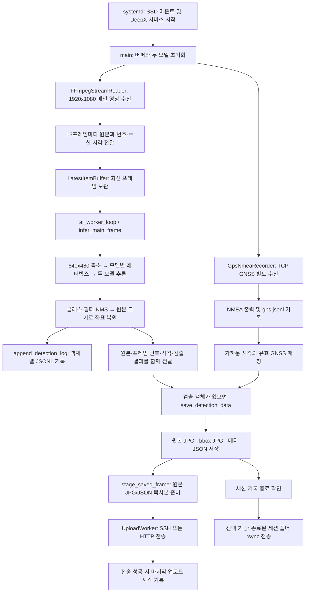

# pothole_rasp

Raspberry Pi에서 RTSP 메인 영상을 받아 DeepX NPU 모델 두 개로 도로 시설물을 검출하는 프로그램입니다. 검출한 원본 이미지, 박스를 그린 이미지, GNSS 좌표를 포함한 JSON을 SSD에 저장하고 설정된 서버로 전송합니다.

실행 진입점은 [`run_main.py`](run_main.py)의 `main()`입니다. 기준 단말은 `192.168.1.125`, 실행 계정은 `hucomputer`입니다.

## 설명할 때의 핵심

> 메인 영상에서 선택한 프레임을 줄여 두 모델에 입력합니다. 검출 결과에는 그때 사용한 원본 이미지와 프레임 번호·시각을 함께 묶습니다. 따라서 박스는 추론에 사용한 이미지와 대응하는 원본 위에 그려집니다. GNSS는 별도 스레드에서 받아 가까운 시각의 유효 좌표를 붙이며, GNSS가 없으면 좌표를 `null`로 두고 검출·저장을 계속합니다. 결과는 먼저 SSD에 저장한 뒤 별도 업로드 스레드에서 전송합니다.

현재 클래스 설정은 빗물받이, 도로반사경, 과속방지턱, 교통신호기, 도로명판, CCTV의 6종입니다. 프로젝트/모델 이름에 pothole이 들어가지만 현재 `POTHOLE_CLASSES`에는 빗물받이만 등록되어 있습니다.

## 동작 순서



1. `main()`이 영상 수신을 시작하고 두 모델을 로드한 뒤 AI·GNSS·전송 작업을 구성합니다.
2. `FFmpegStreamReader.run()`이 메인 스트림을 디코딩합니다. 매 15번째 프레임을 추론 후보로 전달합니다. 이 값은 FPS가 아니라 프레임 간격입니다.
3. `LatestItemBuffer`는 최신 항목 하나를 보관합니다. 추론이 느리면 중간 후보 프레임은 건너뛸 수 있습니다.
4. `infer_main_frame()`이 같은 원본을 640×480으로 줄여 두 모델에 순차 입력합니다. 모델 내부에서는 입력 텐서 크기에 맞춰 레터박스를 적용합니다.
5. 레터박스 좌표를 640×480으로 복원한 뒤 원본 폭·높이 비율을 각각 곱합니다. 결과 버퍼에 `(frame_id, original_frame, frame_timestamp, detections)`를 함께 넣습니다.
6. 메인 루프가 결과를 한 번씩 꺼내 검출이 있는 프레임을 저장합니다. 박스를 그릴 때도 결과에 포함된 원본을 사용합니다.
7. GNSS 매칭과 로컬 저장 후 전송용 복사본을 큐에 넣습니다. 서버 통신은 업로드 스레드가 담당합니다.
8. 종료 신호를 받으면 GNSS 로그와 작업 스레드를 정리하고, 기록이 끝난 세션에 `run_finished`를 남깁니다. systemd는 프로그램 종료 후 DeepX 서비스를 종료합니다.

프레임 시각은 단말이 디코딩된 프레임을 읽은 `time.time()` 값입니다. GNSS 매칭에도 NMEA를 단말에서 수신한 시각을 사용합니다.

## 주요 함수와 클래스

모든 항목은 [`run_main.py`](run_main.py)에 있습니다.

| 영역 | 함수·클래스 | 역할과 연결되는 결과 |
| --- | --- | --- |
| 실행 | `main()` | 모델·스레드 초기화, 결과 소비, 저장 호출, 상태 출력 및 종료 처리 |
| 영상 | `read_exact()` | FFmpeg 파이프에서 프레임에 필요한 바이트를 모아 읽음 |
| 영상 | `FFmpegStreamReader.run()` | RTSP 메인 영상을 NV12로 받아 BGR로 변환하고 원본·번호·시각 전달 |
| 버퍼 | `LatestItemBuffer.put()` / `get_and_clear()` | 최신 데이터 전달, 같은 추론 결과의 중복 소비 방지 |
| 추론 | `ai_worker_loop()` | 후보 프레임 추론, 객체 로그 기록, 해당 원본과 결과를 함께 전달 |
| 추론 | `infer_main_frame()` | 두 모델에 같은 축소 이미지 입력, 원본 크기로 박스 좌표 복원 |
| 모델 | `DeepXPPUModel.infer()` | 레터박스·RGB/텐서 변환, NPU 실행, 대상 클래스 필터 및 여백 제거 |
| 후처리 | `DeepXPPUModel.postprocess_ppu()` | PPU 출력을 박스·점수·클래스로 읽고 임계값 및 클래스별 NMS 적용 |
| GNSS | `GpsNmeaRecorder._open()` / `_run()` | TCP 또는 USB 연결, 비동기 수신, 연결 실패·끊김 재시도 |
| GNSS | `GpsNmeaRecorder._consume_line()` | `[GPS RX]` 출력, NMEA 파싱, 통계 갱신, JSONL 기록 |
| GNSS | `parse_nmea_sentence()` | NMEA 체크섬, GGA/RMC 좌표·fix 등 문장 정보 해석 |
| GNSS | `GpsSession` / `refresh_gps_session()` | 10분 세션 경로 구성과 GNSS 로그 전환 예약 |
| GNSS | `GpsTail.read()` | GNSS JSONL의 추가된 내용을 읽어 시각별 GGA/RMC 이력 구성 |
| 위치 | `matched_gps_position()` / `get_current_gps_fix()` | 시각 차이 1.5초 이내의 유효 좌표 선택, 없으면 `(None, None)` |
| 저장 | `append_detection_log()` | 검출 객체별 클래스·신뢰도·검출 시각을 `logs/detections.jsonl`에 추가 |
| 저장 | `save_detection_data()` | 원본 JPG, bbox JPG, GPS·검출 메타 JSON 저장 |
| 전송 준비 | `stage_saved_frame()` | 저장 완료된 원본 JPG/JSON 쌍의 크기·SHA-256을 구하고 임시 복사본 생성 |
| 실시간 전송 | `UploadWorker.run()` | 전송 큐 처리, 성공/실패 출력, 실패 시 대기 복사본 정리 및 재시도 유예 |
| SSH 전송 | `PersistentUploader.upload()` | 수신 서버가 영속 저장한 결과의 응답·바이트 수·해시 확인 |
| HTTP 전송 | `HttpUploader.upload()` | JPG/JSON 쌍을 multipart API로 전송하고 HTTP 응답 처리 |
| 서버 수신 | `server_transport_source()` / `serve()` | SSH로 실행할 표준 라이브러리 기반 수신 코드를 구성하고 파일을 저장·검증 |
| 세션 전송 | `RawSessionUploader` / `RawUploader.rsync()` | 옵션이 켜져 있으면 종료된 세션 폴더를 rsync로 전송 |
| 세션 마감 | `SessionUploads.finish_sessions()` / `close()` | 기록 중인 GNSS 세션을 제외하고 완료 표시, 작업 종료 순서 관리 |
| 모니터링 | `_signoz_record_upload_success()` | 확인된 전송 성공 시각을 `var/signoz_last_upload.json`에 원자적으로 기록 |

`_signoz_record_upload_success()`는 파일 잠금으로 동시 갱신을 보호하고 기존보다 오래된 성공 시각으로 되돌리지 않습니다. 모니터링 파일 저장이 실패해도 업로드 결과를 실패로 바꾸지 않습니다. 이 함수는 로컬 상태 파일을 갱신하며 SigNoz 서버로 직접 전송하지는 않습니다.

## 저장 파일과 전송 범위

기본 저장 경로는 `/media/hucomputer/DISK/pothole_runs`이며, 단말 로컬 시각을 10분 단위로 묶습니다.

```text
pothole_runs/
└── YYYYMMDD/
    └── YYYYMMDD_HHMM/
        ├── frames/frame_<수신시각_ns>_<프레임번호>.jpg
        ├── frames_bbox/frame_<수신시각_ns>_<프레임번호>.jpg
        ├── meta/frame_<수신시각_ns>_<프레임번호>.json
        ├── meta/run_meta.jsonl      # 기록 종료가 확인된 세션에 생성
        ├── gps/gps.jsonl            # 수신 문장별 JSON 한 줄
        └── logs/detections.jsonl    # 검출 객체별 JSON 한 줄
```

- `frames`는 박스 없는 원본, `frames_bbox`는 같은 원본에 박스를 그린 이미지입니다.
- 메타 JSON에는 `record_id`, `images`, `annotations`, `categories`, `gps`가 들어갑니다. GPS 미수신 시 위도·경도는 `null`입니다.
- 실시간 전송 대상은 **원본 JPG + 메타 JSON**입니다. bbox JPG는 로컬 저장과 선택적인 전체 세션 전송에 포함됩니다.
- SSH 서버 경로는 `<PORTHOLE_UPLOAD_DIR>/porthole_live_analysis/<날짜>/<세션>/certifcate`입니다. `certifcate` 표기는 현재 전송 규약에 포함되어 있습니다.
- `PORTHOLE_RAW_UPLOAD=true`는 종료된 세션의 저장 파일을 전송하는 옵션입니다. 이 프로그램에는 연속 원본 동영상 녹화 기능이 없습니다.
- 이 진입점은 LiDAR PCAP을 생성하지 않으며 기존 PCAP도 전송에서 제외합니다.

### GNSS나 네트워크가 없을 때

GNSS는 별도 스레드에서 재연결하므로 미연결이어도 추론·저장을 계속합니다. 연결 실패 후 대기 시간은 1, 2, 4, 8, 16초를 거쳐 최대 30초가 됩니다. TCP 연결 시도 제한은 3초이며, 연결됐어도 10초 동안 수신이 없으면 다시 연결합니다.

GNSS 상태는 약 10초마다 `[GPS]`, 연결 실패는 `[GPS WARN]`, 수신 원문은 `[GPS RX]`로 출력합니다. 문장을 받지 않았다면 `gps.jsonl`이 비어 있는 것이 정상입니다.

실시간 전송 큐는 최대 100개 대기 항목을 허용합니다. 전송 실패 시 대기 중인 **전송용 임시 복사본**을 버리고 30초 동안 새 전송 접수를 유예합니다. 로컬 원본·메타 파일은 유지되지만, 실패한 실시간 전송이 자동으로 전부 재전송되는 구조는 아닙니다. 종료된 세션 재전송은 별도의 RAW 옵션과 설정이 필요합니다.

전송 코드 일부 메시지에 `CSV only`가 남아 있지만, 현재 검출 기록 함수가 생성하는 파일은 `logs/detections.jsonl`입니다. `porthole_detections.csv`를 새로 만드는 기능은 이 진입점에 없습니다.

## 실행 환경과 설정

필요 구성은 Linux/Raspberry Pi, DeepX 드라이버·DX-RT 서비스·`dx_engine`, Python의 `numpy`·`cv2`, 그리고 `ffmpeg`입니다. SSH 전송에는 SSH 클라이언트와 서버 측 Python 3, 전체 세션 전송에는 `rsync`·`setpriv`가 필요합니다. `auto_update.py`는 추가로 `requests`·`wget`을 사용합니다.

기준 Python은 `/home/hucomputer/dx-runtime/venv-dx-runtime/bin/python3`입니다. DeepX 설치 환경과 모델 버전을 맞춰 사용합니다.

| 항목 | 현재 설정 위치 / 값 |
| --- | --- |
| 카메라 | `main()`의 `main_url`, 메인 채널 `101`, 크기 1920×1080 |
| 추론 후보 간격 | `FFmpegStreamReader.run()`의 `frame_id % 15` |
| 모델 | 스크립트 옆 `pothole_best_ppu.dxnn`, `roadobj_ppu.dxnn` |
| 검출 임계값 | 모델 생성 시 confidence 0.2, NMS IoU 0.45 |
| GNSS | `GPS_DEVICE = "tcp://192.168.5.1:30719"` |
| USB GNSS | `GPS_DEVICE="auto"` 또는 장치 경로, 기본 115200 baud |
| 저장 위치 | `GpsSession`, `save_detection_data`, `SessionUploads` 등의 기본 경로 |
| 화면 표시 | 실행 환경변수 `HEADLESS=1`이면 화면 출력 생략 |

카메라 주소와 GNSS 상수는 현재 코드 설정입니다. 업로드용 `.env`에 같은 이름을 적어도 이 상수들이 바뀌지 않습니다. `HEADLESS`도 업로드용 `.env`를 읽기 전에 평가하므로 서비스의 `Environment=` 또는 실행 명령에서 지정합니다.

업로드 설정은 [`.env.example`](.env.example)을 `.env`로 복사한 뒤 채웁니다. 기존 `.env`가 있으면 필요한 항목만 수정합니다.

| 환경변수 | 용도 |
| --- | --- |
| `PORTHOLE_TERMINAL_ID` | 메타 `record_id`의 단말 식별자, 미지정 시 호스트 이름 |
| `PORTHOLE_UPLOAD_HOST`, `PORTHOLE_UPLOAD_USER` | SSH 서버 주소·계정 |
| `PORTHOLE_UPLOAD_DIR`, `PORTHOLE_UPLOAD_KEY` | 서버 저장 루트·단말의 SSH 개인키 경로 |
| `PORTHOLE_UPLOAD_BW_KIB` | 전송 속도 설정, 기본 24576 KiB/s |
| `PORTHOLE_API_URL`, `PORTHOLE_API_TOKEN` | URL이 있으면 실시간 전송을 HTTP API로 선택 |
| `PORTHOLE_RAW_UPLOAD`, `PORTHOLE_RAW_DIR` | `true`일 때 종료 세션을 SSH/rsync로 전송 |

SSH는 비대화형 키 인증과 `StrictHostKeyChecking=yes`를 사용합니다. 실행 계정의 서버 공개키 등록, 개인키 접근 권한, `known_hosts` 등록이 준비되어 있어야 합니다. 업로드 설정이 없으면 업로드를 끄고 로컬 검출·저장을 계속합니다.

직접 실행할 때는 서비스와 중복 실행하지 않습니다.

```bash
cd /home/hucomputer/pothole_rasp
sudo systemctl stop pothole_rasp.service
HEADLESS=1 /home/hucomputer/dx-runtime/venv-dx-runtime/bin/python3 -u run_main.py
```

## SSD·서비스·운영 로그 설치

[`deploy`](deploy)의 파일은 기준 단말 설정입니다. 다른 장비에서는 계정, 작업 경로, Python 경로, SSD UUID와 UID/GID를 먼저 맞춥니다.

### 1. SSD 고정 마운트

`lsblk -f`, `id hucomputer`로 장치 UUID와 사용자 ID를 확인하고 [`deploy/fstab.ssd.example`](deploy/fstab.ssd.example)의 해당 항목을 `/etc/fstab`에 추가합니다. 기존 OS·부팅 파티션 항목은 유지하고 같은 SSD 항목을 중복 추가하지 않습니다. 다른 경로에 이미 마운트되어 있다면 서비스 중지 후 `findmnt`로 확인한 기존 마운트를 정상 해제합니다.

기준 단말은 UUID `1815-4525`, UID/GID `1000`, 마운트 경로 `/media/hucomputer/DISK`입니다. VFAT 마운트 옵션으로 디렉터리 755, 파일 644 및 `hucomputer` 소유권을 지정합니다.

```bash
sudo mkdir -p /media/hucomputer/DISK
sudo systemctl daemon-reload
sudo findmnt --verify
sudo mount /media/hucomputer/DISK
findmnt -M /media/hucomputer/DISK -o SOURCE,UUID,TARGET,OPTIONS
```

`nofail`로 SSD가 없어도 OS 부팅은 진행합니다. 애플리케이션은 `RequiresMountsFor`와 `ExecStartPre`에서 실제 마운트·쓰기 권한을 확인한 뒤 시작합니다.

### 2. 서비스와 DeepX 종료 순서

```bash
cd /home/hucomputer/pothole_rasp
sudo install -m 0644 deploy/pothole_rasp.service /etc/systemd/system/pothole_rasp.service
sudo install -d /etc/systemd/system/pothole_rasp.service.d
sudo install -m 0644 deploy/pothole_rasp.service.d/*.conf /etc/systemd/system/pothole_rasp.service.d/
sudo systemctl daemon-reload
sudo systemctl enable --now dxrt.service
sudo systemctl enable pothole_rasp.service
sudo systemctl restart pothole_rasp.service
```

`deepx-ordering.conf`의 `Wants=dxrt.service`는 DeepX 서비스 시작도 요청하고, `After=dxrt.service`는 두 서비스의 시작·종료 순서를 정합니다. 부팅 때 DeepX 서비스가 먼저 시작하고, 함께 종료할 때는 `pothole_rasp`가 먼저 끝납니다. DeepX가 먼저 종료돼 자원 정리 중 `errno=107 / Dynamic IPC task deinit failed`가 발생했던 순서 문제를 방지하는 설정입니다.

### 3. 운영 로그 영구 저장과 30일 정리

```bash
sudo install -d /etc/systemd/journald.conf.d
sudo install -m 0644 deploy/journald/90-pothole-retention.conf /etc/systemd/journald.conf.d/
sudo systemd-tmpfiles --create --prefix /var/log/journal
sudo systemctl restart systemd-journald.service
sudo journalctl --flush
sudo journalctl --sync
```

`Storage=persistent`로 `/var/log/journal`에 저장하고, `MaxFileSec=1day`로 파일을 분리하며, `MaxRetentionSec=30day`로 오래된 운영 로그를 자동 정리합니다. 별도 cron은 필요하지 않습니다. 30일은 최대 보존 기간이며 journald의 기본 용량 제한에 도달하면 더 일찍 정리될 수 있습니다.

이 정책의 대상은 systemd 운영 로그입니다. SSD의 검출 이미지·GNSS JSONL과 `auto_update.py`의 `update.log`에는 이 보존 정책이 적용되지 않습니다.

## 운영 확인과 문제 구분

```bash
systemctl status pothole_rasp.service dxrt.service
systemctl show pothole_rasp.service -p MainPID -p NRestarts -p ActiveState
journalctl -u pothole_rasp.service -f
journalctl -u pothole_rasp.service --since "30 days ago"
journalctl -u pothole_rasp.service -b -1
findmnt -M /media/hucomputer/DISK
```

| 로그·증상 | 확인할 내용 |
| --- | --- |
| `[GPS] connected=False` / `timed out` | GNSS 서버·네트워크 연결. 프로그램은 계속 실행하고 좌표를 `null`로 저장 |
| `Permission denied ... pothole_runs` | SSD 마운트 경로, UUID, uid/gid, 실행 계정 쓰기 권한 |
| `[UPLOAD] verified ...` | 해당 실시간 전송이 구현된 성공 조건을 통과함 |
| `[UPLOAD] cannot send ...` | 서버 연결·키·호스트 신뢰·쓰기 권한. 전송 대기 복사본을 정리함 |
| `[UPLOAD MONITOR] ...` | 업로드 성공 시각을 담는 로컬 모니터링 파일 저장 실패 |
| 종료 중 `Dynamic IPC task deinit failed` | 이전 부팅 로그에서 `dxrt.service`가 먼저 종료됐는지, ordering drop-in 적용 여부 확인 |

`active/running`만으로 실제 카메라 프레임 수신·추론·서버 수신까지 모두 성공했다고 판단하지 않습니다. 최신 `frames`, `meta`, `logs/detections.jsonl` 생성과 `[UPLOAD] verified`를 함께 확인합니다.

## 업데이트와 테스트

`auto_update.py`는 설정된 Git `origin/main`을 가져오고 Hugging Face 모델 커밋을 확인한 뒤 Tailscale 주소를 점검합니다. 함수 이름 `update_github()`와 메시지에는 GitHub가 남아 있지만 실제 저장소는 `origin` 설정을 따릅니다. [`crontab_cmd.txt`](crontab_cmd.txt)는 매일 00·12·18시 실행 예시입니다. 기준 단말의 origin은 GitLab `hudaters_lab1/pothole_rasp`입니다.

자동 업데이트 스크립트는 서비스 재시작이나 충돌 해소를 수행하지 않으며, `TAILSCALE_IP` 값도 별도로 확인해야 합니다. 단말에서 소스를 직접 수정하기보다 저장소에 커밋·푸시한 버전을 받아 사용합니다. `deploy` 파일은 Git 업데이트만으로 `/etc`에 적용되지 않으므로 변경한 설정을 위 설치 명령으로 반영합니다.

```bash
cd /home/hucomputer/pothole_rasp
git status --short
git pull --ff-only
/home/hucomputer/dx-runtime/venv-dx-runtime/bin/python3 -m unittest -v
```

- `test_frame_alignment.py`: 같은 원본·프레임 번호·시각 유지, 좌표 배율 복원, 결과별 저장 검증.
- `test_gps_tcp.py`: 분할 NMEA 수신, 잘못된 fix·체크섬, 연결 실패·단절·무수신 재접속, 로그 전환과 좌표 매칭 검증.

테스트는 NPU 엔진 실행을 대체하고 로컬 TCP 테스트 서버를 사용합니다. 모듈을 읽기 위해 `dx_engine`, OpenCV, NumPy가 설치된 실행 환경이 필요합니다. 실제 카메라 검출과 원격 서버 전송 시험은 별도로 수행합니다.

2026-10-12 기준 단말에서 기존 테스트 10개와 업로드 성공 상태 파일의 동시 갱신·실패 격리 검증을 통과했습니다. 종료 순서 설정 적용 후 실제 재부팅 1회에서 `pothole_rasp` 종료 완료 → `dxrt` 종료 순서를 확인했고, 기존 `errno=107 / Dynamic IPC task deinit failed`는 재발하지 않았습니다. 재부팅 후 두 모델 로드, 서비스 재시작 0회, SSD 고정 마운트와 이전 운영 로그 보존을 확인했습니다.
